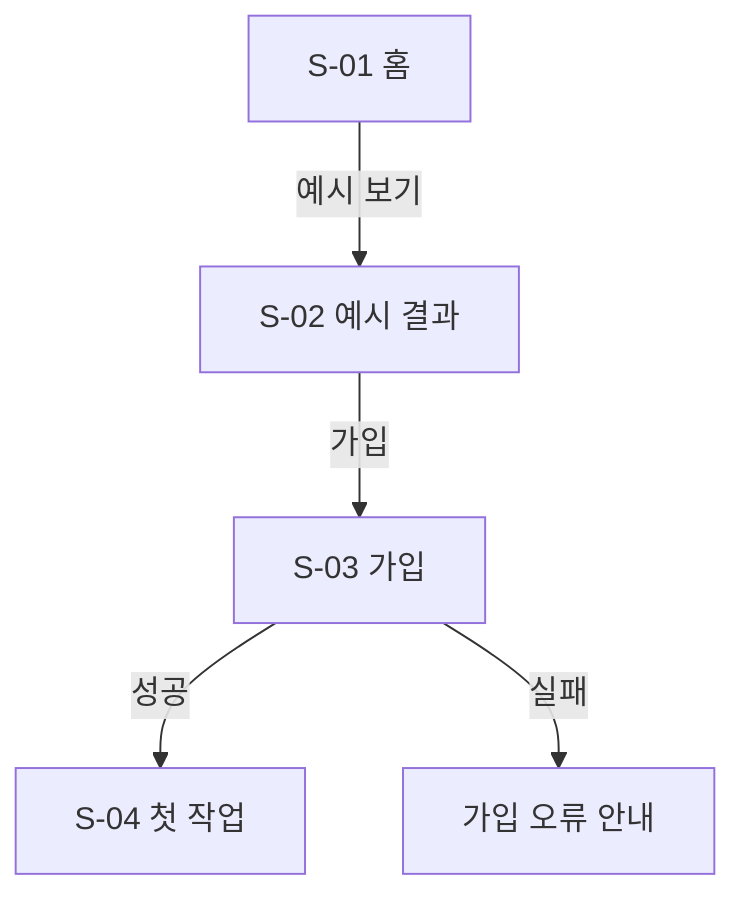

# [서비스 이름] 화면 목록과 흐름

> 양식 사용법: `docs/screens.md`로 복사. 연구 데모는 ★ 절만(웹·앱 차이 생략). 화면 ID는 유저 스토리·목업 파일명과 맞춘다(`docs/mockups/S-01-home.html`). 설계 기준은 폰 화면(360~390px).

## 화면 목록 ★
| ID | 화면 | 목적(사용자가 여기서 끝내는 일) | 진입 경로 | 관련 스토리 | 목업 |
|---|---|---|---|---|---|
| S-01 | 홈 | | | US-01 | `mockups/S-01-home.html` |

## 흐름 (Mermaid) ★

- 정상 흐름뿐 아니라 실패·취소·뒤로 가기 경로를 그린다. 막다른 화면(나갈 길이 없는 화면)이 없어야 한다.
- 화면이 10개를 넘으면 여정별로 흐름도를 나눈다.

## 화면별 상태 ★
| 화면 | 기본 | 빈 상태 | 로딩 | 오류 | 권한 거부·비로그인 | 오프라인 |
|---|---|---|---|---|---|---|
| S-01 | | 처음 온 사용자에게 보일 것 | | 입력 유지 + 재시도 | | |
- 빈 상태는 "데이터 없음"이 아니라 **다음 행동**을 안내한다.

## 웹·앱 차이
| 항목 | 모바일 웹 | 앱 |
|---|---|---|
| 알림 | 이메일·웹 푸시(지원 범위 `[확인 필요]`) | 푸시 |
| 권한 요청 시점 | | |
| 뒤로 가기 | 브라우저 | OS 제스처·버튼 |
| 딥링크 | URL | 앱 링크 |
